# CitizenTech: onde o sol não vira painel

**Energia solar distribuída no Brasil: quem está ficando de fora da transição energética**

**Aluno:** Anderson Huang · **RM:** 565920 · **Disciplina:** Big Data & Analytics (Global Solution 2026.2) · **Tema:** Sustentabilidade

Pipeline de Big Data & Analytics que cruza 4,7 milhões de instalações solares registradas na ANEEL com dados de irradiação solar do INPE, tarifas de energia e dados socioeconômicos do IBGE para responder a uma pergunta: **a energia solar está chegando onde o sol é mais forte e onde a conta de luz mais pesa, ou apenas onde há renda?**

| Entregável | Onde está |
|---|---|
| Investigação do problema | [seção 1](#1-investigação-do-problema) |
| Catálogo de dados | [seção 2](#2-catálogo-de-dados) |
| Arquitetura da solução | [seção 3](#3-arquitetura-da-solução) e [`docs/img/00_arquitetura.png`](docs/img/00_arquitetura.png) |
| Pipeline implementado | [`pipeline/`](pipeline) e [seção 4](#4-pipeline-implementado) |
| Feature Engineering | [seção 5](#5-feature-engineering) |
| Camada analítica | `data/gold/` e [seção 6](#6-camada-analítica-e-indicadores) |
| Análises | [seção 7](#7-análises-avançadas) |
| Dashboard | [`docs/dashboard.html`](docs/dashboard.html) e [seção 8](#8-dashboard) |
| Experimentação Spark | [`databricks/`](databricks) e [seção 9](#9-experimentação-com-databricks-e-apache-spark) |
| Relatório executivo | [`relatorio-executivo.md`](relatorio-executivo.md) |

> **Indo além do enunciado.** Como contribuição adicional, que não fazia parte dos entregáveis pedidos, o projeto também traz uma camada de **governança de dados no Unity Catalog**: dicionário de dados no próprio banco, tags de classificação e linhagem automática das tabelas. Veja a [seção 11](#11-indo-além-do-enunciado-governança-e-linhagem-de-dados).

## 1. Investigação do problema

**Problema.** A micro e minigeração distribuída solar (painéis em telhados, fazendas solares de autoconsumo remoto) é a fonte de energia que mais cresce no Brasil: passou de 0,4 GW conectados em 2018 para 54,6 GW em 2026. O consumidor que instala painéis reduz a conta de luz por décadas. A pergunta é **quem está capturando esse benefício**. Se a adoção depende de renda e não do potencial solar, a transição energética amplia desigualdades: regiões e famílias de menor renda continuam pagando tarifas cheias enquanto subsidiam, via tarifa, a rede usada por quem já gera a própria energia.

**Quem é afetado.**

- Famílias de baixa renda e municípios pobres, que gastam proporcionalmente mais com energia e têm menos acesso a crédito para investir em painéis.
- O Nordeste, que tem a maior irradiação solar do país e, portanto, o maior retorno por painel instalado.
- Gestores públicos (MME, ANEEL, governos estaduais, bancos públicos de fomento como BNB e Caixa) que desenham programas de crédito, habitação social e incentivo.

**Dimensão analisada.** A distribuição territorial (município, UF, região) da adoção solar e sua relação com potencial solar, renda, tarifa, tipo de moradia e porte do município, além da evolução no tempo (2012 a 2026).

**Decisões que os dados podem melhorar.**

1. Onde concentrar linhas de crédito e programas de energia solar para baixa renda.
2. Quais municípios estão abaixo do esperado para o seu perfil e merecem ação local (campanhas, cooperativas, geração compartilhada).
3. Em quais cidades a barreira é a moradia vertical (apartamentos), e não a renda, o que pede geração compartilhada em vez de telhado próprio.
4. Como acompanhar se a política está funcionando (indicadores e metas).

**Informações necessárias.** Onde estão os sistemas e de que tipo são (ANEEL), quanto sol cada município recebe (INPE), quanto custa a energia em cada distribuidora (ANEEL), e quantas pessoas, domicílios, apartamentos e qual a renda de cada município (IBGE).

**Viabilidade.** Todas as fontes são públicas, oficiais, gratuitas e acessíveis por download ou API. A ANEEL e o IBGE usam o mesmo código de município, o que permite integrar as bases com precisão.

## 2. Catálogo de dados

| # | Fonte | Acesso | Volume | Atributos usados | Atualização |
|---|---|---|---|---|---|
| 1 | **ANEEL**, Relação de empreendimentos de geração distribuída | [Parquet](https://dadosabertos.aneel.gov.br/dataset/relacao-de-empreendimentos-de-geracao-distribuida) | 4.735.908 linhas, 108 MB | código do empreendimento, município IBGE, distribuidora (CNPJ), classe de consumo, modalidade, porte, tipo de geração, potência (kW), data de atualização cadastral | mensal |
| 2 | **ANEEL**, Tarifas homologadas das distribuidoras | [Parquet](https://dadosabertos.aneel.gov.br/dataset/tarifas-distribuidoras-energia-eletrica) | 657.709 linhas | CNPJ da distribuidora, subgrupo, classe, modalidade, vigência, TUSD e TE (R$/MWh) | a cada reajuste |
| 3 | **INPE/LABREN**, Atlas Brasileiro de Energia Solar 2017 | [CSV por sede municipal](https://labren.ccst.inpe.br/atlas_2017.html) | 5.569 municípios | nome, UF, latitude, longitude, irradiação média anual no plano inclinado (Wh/m²/dia) | estático (climatologia de 17 anos) |
| 4 | **IBGE**, Censo 2022, tabela 4714 | [API SIDRA](https://apisidra.ibge.gov.br/values/t/4714/n6/all/v/93,6318/p/2022) | 5.570 municípios | população residente, área | decenal |
| 5 | **IBGE**, Censo 2022, tabela 4712 | [API SIDRA](https://apisidra.ibge.gov.br/values/t/4712/n6/all/v/381/p/2022) | 5.570 municípios | domicílios particulares permanentes ocupados | decenal |
| 6 | **IBGE**, Censo 2022, tabela 6326 | [API SIDRA](https://apisidra.ibge.gov.br/values/t/6326/n6/all/v/1000381/p/2022/c125/3247) | 5.570 municípios | % de domicílios do tipo apartamento | decenal |
| 7 | **IBGE**, PIB dos Municípios 2023, tabela 5938 | [API SIDRA](https://apisidra.ibge.gov.br/values/t/5938/n6/all/v/37/p/2023) | 5.570 municípios | PIB a preços correntes | anual |
| 8 | **IBGE**, API de Localidades | [JSON](https://servicodados.ibge.gov.br/api/v1/localidades/municipios?view=nivelado) | 5.571 municípios | código, nome, UF, região, região intermediária | sob demanda |

**Por que essas fontes e como se combinam.**

- A ANEEL é o registro oficial e completo de toda conexão de micro e minigeração no país (Resolução Normativa 1.000/2021). Sozinha, ela só diz onde há painéis.
- O Atlas Solar do INPE mede o **potencial**: quanto cada painel gera em cada lugar. É ele que permite dizer que uma adoção baixa é desperdício de potencial.
- A tarifa da ANEEL transforma geração em **dinheiro economizado** pelo consumidor.
- O IBGE normaliza tudo por população e domicílios e traz os fatores explicativos (renda, verticalização, porte).
- Chaves de integração: código IBGE do município (ANEEL e IBGE), CNPJ da distribuidora (geração distribuída e tarifas, 100% de correspondência) e nome + UF (INPE, que não tem código IBGE).

**Confiabilidade e achados de qualidade.**

- **Dados pessoais:** a base da ANEEL traz nome e CPF/CNPJ (parcialmente mascarado) do titular e CEP. Essas colunas são descartadas já na ingestão, porque a análise não precisa delas (princípio da minimização da LGPD).
- **Data de conexão:** a ANEEL publica a data da última atualização cadastral, que na prática coincide com a conexão para a grande maioria dos registros. 71 registros têm datas anteriores a 2009, 69 deles com o ano 1900 (valor sentinela), e a data vira nulo.
- **Atraso de registro:** os últimos meses da base aparecem incompletos (em setembro/2026 há 13 mil conexões contra uma média de 75 mil). O pipeline detecta isso automaticamente e só usa meses com pelo menos 80% da mediana dos 12 meses anteriores. O período estável vai até **maio/2026**.
- **Erro na fonte do INPE:** Porto Alegre aparece no arquivo do Atlas Solar com o estado "Rio Grande do Norte" (as coordenadas são do RS). Outros nomes mudaram desde 2017 (Campo Grande/RN era Augusto Severo, Assú era Açu). Foram tratados com uma tabela de exceções documentada no código.
- **Baixa renda subnotificada:** só 27 das 102 distribuidoras usam a classe "Residencial baixa renda" (REBR) no cadastro. O indicador de baixa renda existe na Gold, mas não foi usado em conclusões.

## 3. Arquitetura da solução

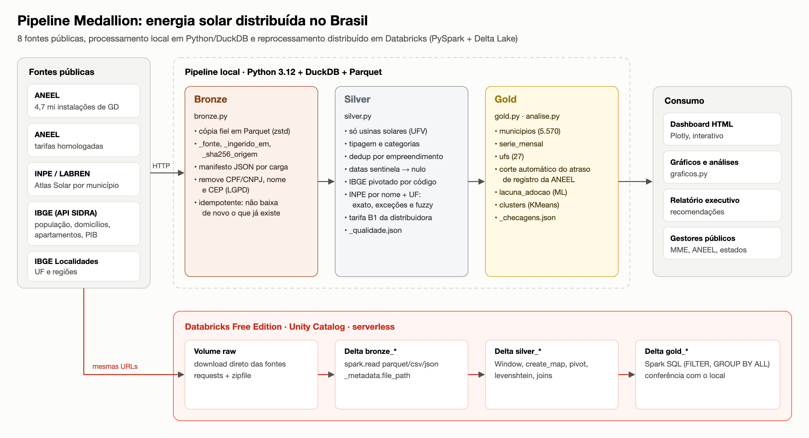

| Camada | Conteúdo | Decisões técnicas |
|---|---|---|
| **Pouso** (`data/raw`) | arquivos originais como baixados | Preserva a fonte para auditoria e reprocessamento sem depender da disponibilidade dos portais. |
| **Bronze** (`data/bronze`) | uma tabela Parquet por fonte, fiel à origem | Parquet com compressão zstd (108 MB viram 38 MB). Colunas de linhagem `_fonte`, `_ingerido_em` e `_sha256_origem` em cada linha e um `_manifesto.json` por carga com URL, hash, linhas e colunas. Ingestão idempotente. Remoção de dados pessoais. |
| **Silver** (`data/silver`) | `instalacoes_solares` (4.734.997 linhas) e `municipios` (5.571 linhas) | SQL em DuckDB (motor colunar embarcado, processa os 4,7 milhões de linhas em segundos com pouca memória). Categorias padronizadas, deduplicação, integração das 8 fontes, relatório `_qualidade.json`. |
| **Gold** (`data/gold`) | `municipios`, `serie_mensal`, `ufs`, `lacuna_adocao`, `clusters` | Tabelas prontas para análise e dashboard. Inclui municípios sem nenhum sistema solar (necessário para taxas justas). Checagem de que a soma da Gold bate com a Silver (`_checagens.json`). |

**Por que essa stack.** O volume (4,7 milhões de linhas) cabe em uma máquina, então o pipeline principal usa Python + DuckDB, que é simples de executar e reproduzir. A mesma lógica foi reimplementada em PySpark no Databricks (seção 9) para mostrar como o pipeline escala quando o volume não couber mais em uma máquina, por exemplo com o histórico mensal completo da ANEEL ou dados de medição horária.

**Qualidade, rastreabilidade, atualização e confiabilidade.**

- **Qualidade:** cada camada grava as contagens de entrada, descartes e correspondências (`_qualidade.json`, `_checagens.json`). O notebook do Databricks tem `assert` para duplicados e instalações sem município.
- **Rastreabilidade:** toda linha da Bronze sabe de qual URL e de qual arquivo (hash SHA-256) veio, e quando foi ingerida.
- **Atualização:** a ANEEL atualiza a base mensalmente. Rodar `bronze.py` com a opção de atualizar baixa a versão nova, e as demais etapas são determinísticas.
- **Confiabilidade:** a Silver e a Gold do Databricks bateram com o pipeline local linha a linha (4.734.997 instalações, 54.609,1 MW).

## 4. Pipeline implementado

```bash
uv sync                          # Python 3.12 + dependências
cd pipeline
uv run python bronze.py          # baixa as 8 fontes (cerca de 1 minuto)
uv run python silver.py          # limpeza e integração
uv run python gold.py            # indicadores
uv run python analise.py         # correlações, modelo e clusters
uv run python graficos.py        # figuras em docs/img
uv run python dashboard.py       # docs/dashboard.html
```

| Arquivo | Etapa | O que faz |
|---|---|---|
| [`config.py`](pipeline/config.py) | configuração | URLs, caminhos e parâmetros |
| [`bronze.py`](pipeline/bronze.py) | Bronze | download, conversão para Parquet, linhagem, manifesto |
| [`silver.py`](pipeline/silver.py) | Silver | filtro solar, tipagem, padronização, deduplicação, integração IBGE + INPE + tarifas |
| [`gold.py`](pipeline/gold.py) | Gold | corte do período estável, indicadores por município, mês e UF |
| [`analise.py`](pipeline/analise.py) | analytics | correlações, modelo de lacuna de adoção, clusters |
| [`graficos.py`](pipeline/graficos.py) / [`dashboard.py`](pipeline/dashboard.py) | visualização | figuras estáticas e dashboard interativo |

**Resultado da Silver** (`data/silver/_qualidade.json`):

| Checagem | Resultado |
|---|---|
| Registros na Bronze | 4.735.908 |
| Não solares removidos (térmicas, eólicas, hídricas) | 905 |
| Potência inválida ou duplicados | 6 |
| Instalações solares na Silver | 4.734.997 |
| Instalações sem município no IBGE | 0 |
| Municípios com irradiação: exato / exceção manual / aproximado / sem dado | 5.552 / 7 / 10 / 2 (Fernando de Noronha e Boa Esperança do Norte, criado em 2025) |
| Municípios sem tarifa (sem nenhum sistema solar) | 4 |

## 5. Feature Engineering

| Feature | Construção | Por que importa |
|---|---|---|
| `watts_por_habitante` | potência total × 1000 / população | Adoção comparável entre municípios de tamanhos diferentes |
| `telhados_solares_por_mil_dom` | sistemas residenciais com geração na própria unidade / domicílios × 1000 | Penetração real em residências, sem contar fazendas solares de autoconsumo remoto que inflam municípios pequenos |
| `pib_per_capita` | PIB 2023 / população 2022 | Proxy de renda e capacidade de investimento |
| `irradiacao_kwh_m2_dia` | irradiação no plano inclinado / 1000 | Potencial físico de geração |
| `geracao_kwh_por_kwp_ano` | irradiação × 365 × 0,75 (performance ratio típico) | Quanto 1 kWp gera por ano no município |
| `economia_r_por_kwp_ano` | geração por kWp × tarifa B1 da distribuidora | Retorno financeiro do painel, unindo sol e preço da energia |
| `tarifa_b1_r_kwh` | (TUSD + TE) da tarifa residencial convencional vigente da distribuidora principal | Quanto a energia pesa no bolso |
| `pct_apartamentos` | % de domicílios do tipo apartamento | Barreira física ao telhado próprio |
| `pct_kw_autoconsumo_remoto`, `pct_kw_rural` | participação na potência | Diferencia adoção doméstica de investimento e agronegócio |
| `kw_ultimos_12m`, `crescimento_12m_pct` | potência conectada nos 12 meses do período estável e variação contra os 12 anteriores | Momento do mercado, sem o viés do atraso de registro |
| `telhados_esperados_por_mil_dom`, `razao_adocao`, `telhados_faltantes` | previsão do modelo (seção 7) e diferença para o observado | Mede quanto o município está abaixo do que seu perfil permitiria |
| `economia_nao_capturada_r_ano` | telhados faltantes × 5 kWp (mediana residencial) × economia por kWp | Traduz a lacuna em reais por ano |

## 6. Camada analítica e indicadores

| Indicador | Definição | Dados | Resultado | Interpretação para decisão |
|---|---|---|---|---|
| Potência instalada | soma da potência dos sistemas solares | ANEEL | **54,6 GW**, 4,73 milhões de sistemas | Dimensão do mercado |
| W por habitante | potência / população | ANEEL + IBGE | Brasil 269. MT 872, MS 699, PR 600. AM 115, RJ 130, SE 147 | Onde a adoção está concentrada |
| Telhados por mil domicílios | sistemas residenciais próprios / domicílios | ANEEL + IBGE | Centro-Oeste 70, Sul 47, Sudeste 33, **Nordeste 30** | Acesso das famílias à geração própria |
| Participação Nordeste | % da potência vs % da população | ANEEL + IBGE | **20,6% da potência para 26,9% da população** | Sub-representação da região com mais sol |
| Economia por kWp/ano | geração × tarifa | INPE + ANEEL | Centro-Oeste R$ 1.353, Norte R$ 1.226, **Nordeste R$ 1.216**, Sul R$ 1.039 | Um painel no Nordeste rende 17% mais que no Sul |
| Concentração | % da potência nos 10% maiores municípios | ANEEL | 58,8% | Mercado muito concentrado |
| Autoconsumo remoto | % da potência em fazendas solares remotas | ANEEL | 29,1% | Parte relevante é investimento, não telhado |
| Crescimento em 12 meses | jun/25 a mai/26 contra jun/24 a mai/25 | ANEEL | Brasil -2,3%, **Nordeste +12,4%** (única região em alta) | O Nordeste começou a reagir, momento certo para política pública |

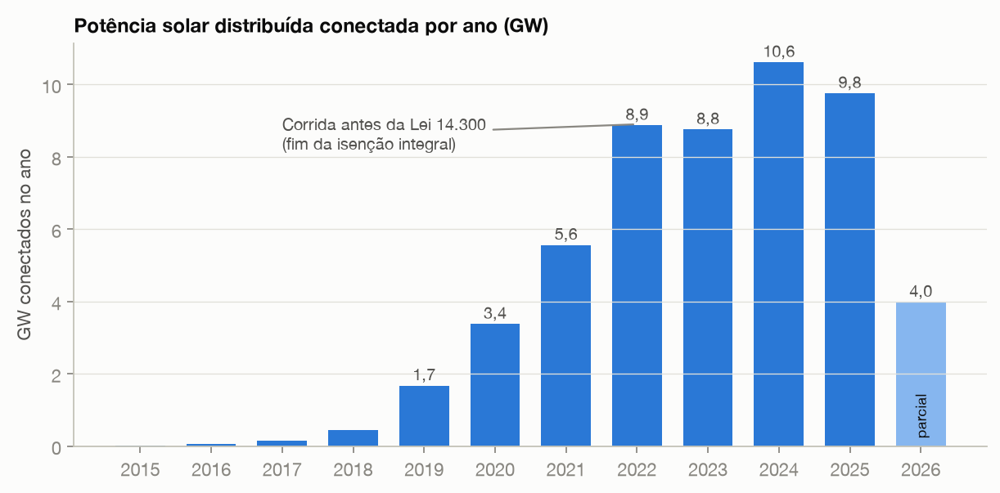

A curva mostra a corrida de 2022 antes da Lei 14.300 (que acabou com a isenção integral da tarifa de uso da rede para novos sistemas a partir de 2023), a queda em 2023 e a recuperação em 2024. 2026 está incompleto por causa do atraso de registro.

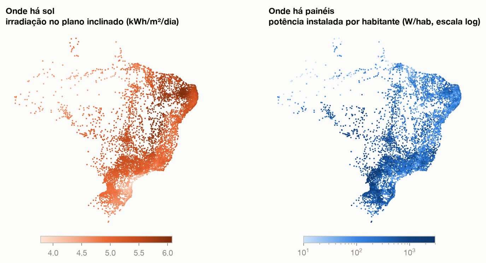

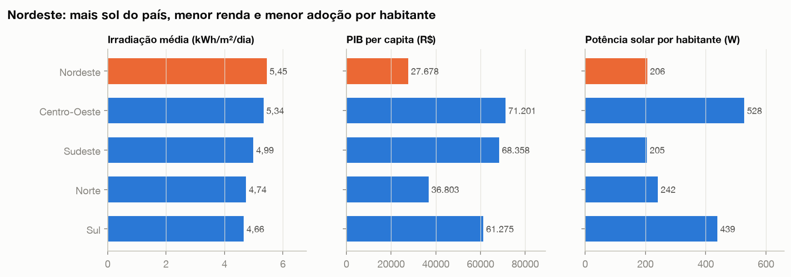

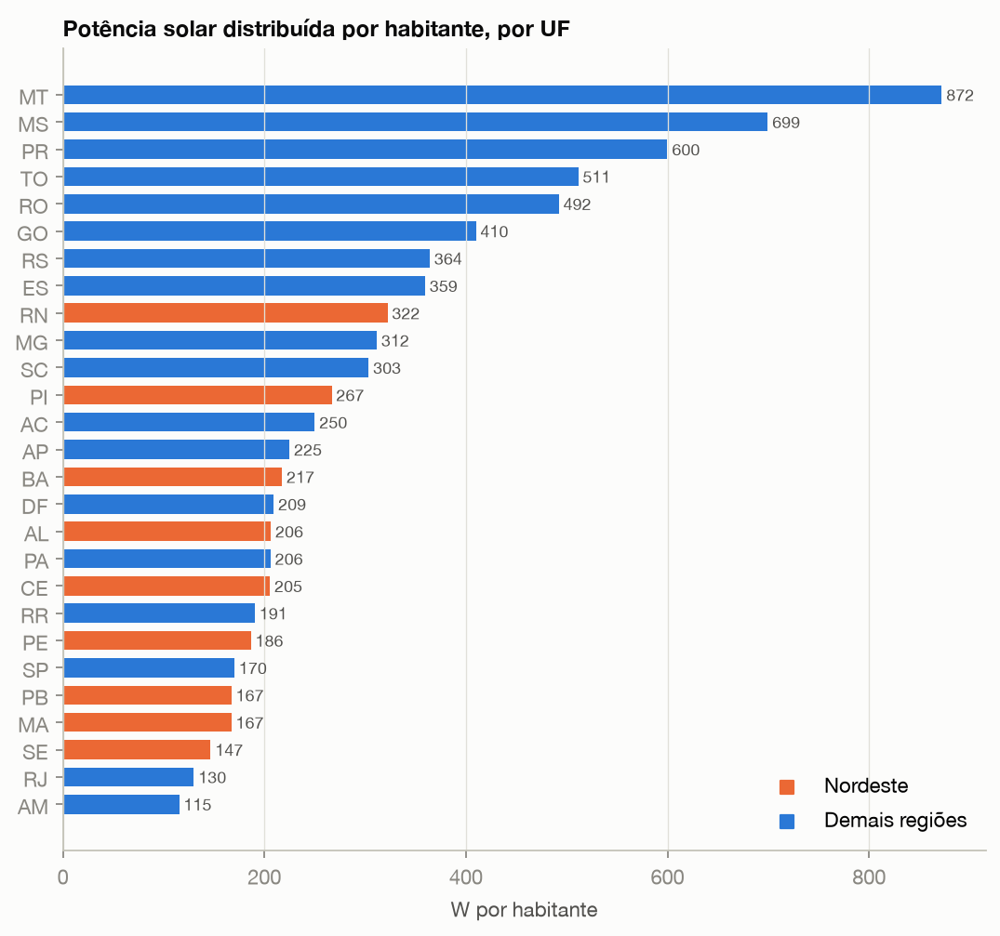

## 7. Análises avançadas

### 7.1 Correlação: renda explica, sol não

Correlação de Spearman entre fatores e adoção nos 5.565 municípios com dados completos. Spearman foi escolhido porque as variáveis são muito assimétricas (W/hab vai de 0 a 7.939) e a relação esperada é monotônica, não necessariamente linear.

| Fator | W por habitante | Telhados por mil domicílios |
|---|---|---|
| PIB per capita | **0,59** | **0,52** |
| % rural da potência | 0,38 | 0,16 |
| Tarifa residencial | 0,07 | 0,15 |
| % de apartamentos | 0,14 | 0,15 |
| Irradiação solar | **-0,07** | -0,02 (não significativo) |
| População | -0,17 | -0,03 (não significativo) |

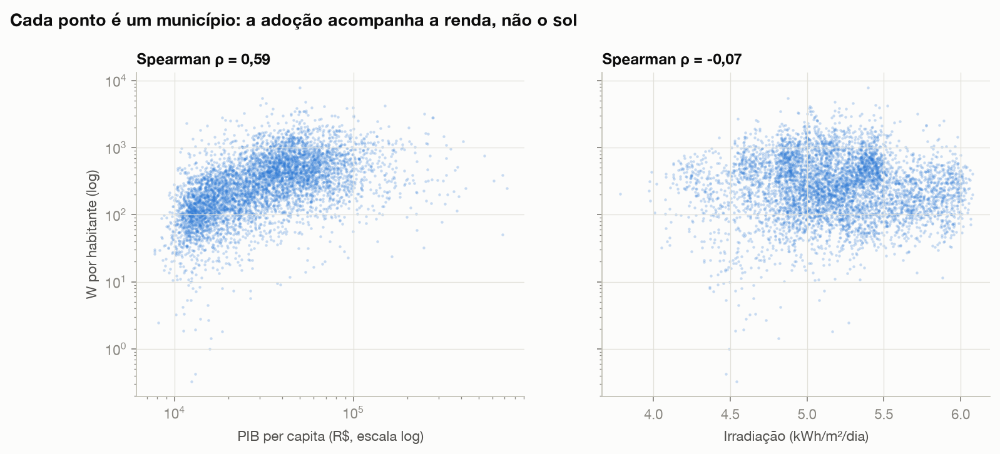

### 7.2 Modelo de adoção esperada (Machine Learning)

**Objetivo.** Estimar quantos telhados solares por mil domicílios cada município "deveria" ter, dado o seu perfil, e encontrar os que estão abaixo disso. Não é um modelo para prever o futuro, e sim um padrão de comparação justo: comparar Salvador com municípios de renda, sol, tarifa e verticalização parecidos, e não com Cuiabá.

**Método.** Regressão com Gradient Boosting (`HistGradientBoostingRegressor`) sobre `log(1 + telhados por mil domicílios)`, com 6 fatores estruturais: PIB per capita (log), irradiação, tarifa, % de apartamentos, população (log) e densidade (log). A previsão de cada município é feita **fora da amostra** (validação cruzada com 5 folds), então nenhum município é usado para prever a si mesmo.

| Modelo | R² (KFold) | MAE (telhados/mil dom.) | R² (validação por UF) |
|---|---|---|---|
| Baseline (média) | 0,00 | 27,2 | -0,03 |
| Regressão linear | 0,28 | 24,5 | 0,23 |
| **Gradient Boosting** | **0,62** | **16,8** | -0,02 |

**Leitura das métricas.** O Gradient Boosting explica 62% da variação e reduz o erro em 38% em relação ao baseline. Porém, quando um estado inteiro fica de fora do treino (validação por UF), o desempenho cai a zero: o modelo aprende padrões regionais (distribuidora, mercado local, histórico de incentivos estaduais) que não se transferem para um estado que ele nunca viu. Por isso ele é usado apenas para comparar municípios dentro do contexto conhecido, que é o uso pretendido, e não para estimar estados novos.

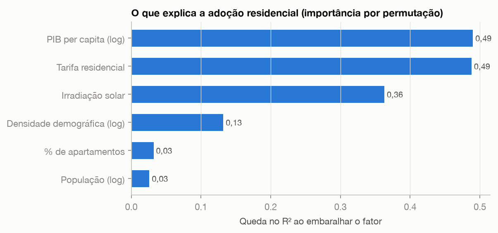

Importância por permutação (queda do R² ao embaralhar cada fator): renda (0,49) e tarifa (0,49) dominam. A irradiação aparece (0,36) porque, combinada com os outros fatores, ajuda a separar regiões, embora sozinha não tenha correlação com a adoção.

**Resultado.** Somando a diferença entre esperado e observado, há **373 mil telhados residenciais abaixo do esperado** no país, o equivalente a **R$ 2,25 bilhões por ano** de economia na conta de luz que as famílias deixam de capturar.

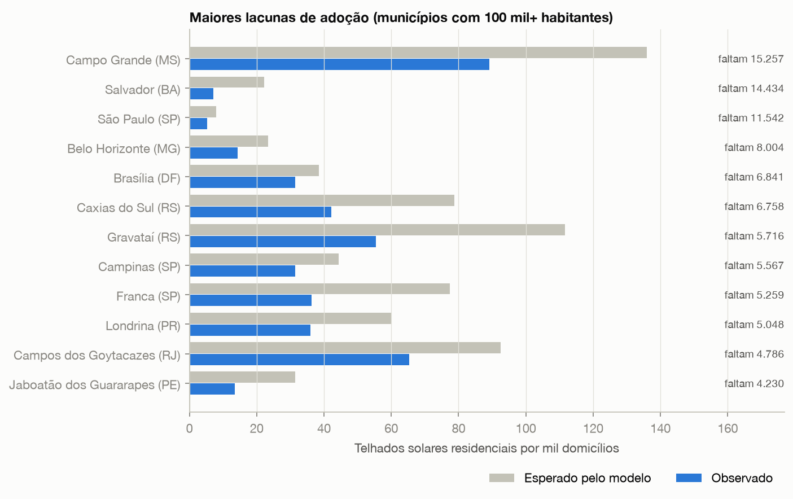

Salvador (28% de apartamentos) tem 7 telhados solares por mil domicílios, quando o esperado seria 22. Jaboatão dos Guararapes, Caucaia e Recife aparecem na mesma situação. São cidades do Nordeste com sol forte e tarifa média, onde a barreira é renda e moradia.

**Limitações.** O PIB per capita é uma proxy imperfeita de renda das famílias (o Censo 2022 ainda não publicou renda domiciliar por município em todas as tabelas). O modelo não vê crédito disponível, informalidade da moradia nem ICMS estadual. A lacuna é uma estimativa para priorização, não uma meta exata.

### 7.3 Perfis de municípios (clusterização)

KMeans sobre 6 variáveis padronizadas (W/hab em log, PIB per capita em log, irradiação, % rural, % autoconsumo remoto, % da potência conectada nos últimos 12 meses), em 5.532 municípios com pelo menos 10 sistemas. O número de grupos (k = 5) foi escolhido pela maior silhueta entre k = 3 e 7.

| Perfil | Municípios | População | W/hab (mediana) | PIB per capita | Irradiação | Destaque |
|---|---|---|---|---|---|---|
| Consolidados de alta renda | 1.473 | 63,7 mi | 534 | R$ 50 mil | 5,22 | Interior do Sul, Sudeste e Centro-Oeste |
| Agro solar | 1.190 | 10,1 mi | 473 | R$ 41 mil | 4,95 | 44% da potência em propriedades rurais |
| Expansão recente | 294 | 4,8 mi | 258 | R$ 22 mil | 5,31 | 55% da potência conectada nos últimos 12 meses |
| **Muito sol, baixa renda** | **1.676** | **48,4 mi** | **141** | **R$ 15 mil** | **5,48** | 88% no Nordeste. Metade da potência é autoconsumo remoto (investidores de fora) |
| Urbanos de baixa adoção | 899 | 75,6 mi | 139 | R$ 27 mil | 4,80 | Regiões metropolitanas e litoral do Sudeste e Norte |

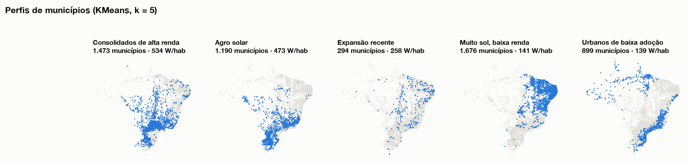

**Limitações.** A silhueta de 0,20 indica grupos com sobreposição. Os perfis servem para orientar o tipo de política, não como categorias rígidas.

## 8. Dashboard

[`docs/dashboard.html`](docs/dashboard.html) é um painel interativo (Plotly) que abre em qualquer navegador: indicadores principais, mapa de W/hab por município com detalhes ao passar o mouse, evolução mensal por região, comparação entre UFs e a tabela de lacunas.

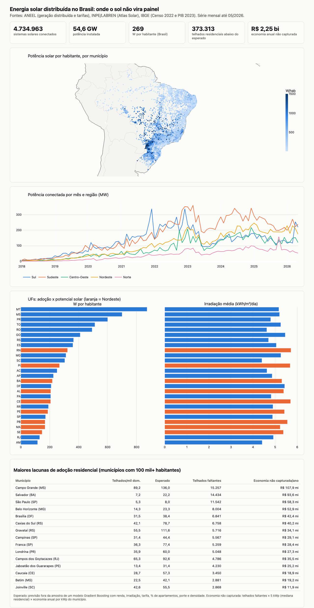

## 9. Experimentação com Databricks e Apache Spark

O notebook [`databricks/pipeline_energia_solar.py`](databricks/pipeline_energia_solar.py) reimplementa o pipeline inteiro (Bronze, Silver e Gold) em PySpark com tabelas Delta no Databricks Free Edition.

**Como executar.** Workspace > Import > arquivo `databricks/pipeline_energia_solar.py` > Run all. O notebook cria o schema `workspace.energia_solar` e o volume `raw`, baixa as 8 fontes direto das URLs públicas e grava 13 tabelas Delta.

| O que foi investigado | Como foi feito no notebook |
|---|---|
| Carregar datasets | `spark.read.parquet` (ANEEL), `spark.read.csv` com separador `;` (INPE), `spark.read.json` com `multiLine` (IBGE) |
| Transformações em DataFrames | `select`, `cast`, `trim`, `create_map` para padronizar categorias, `when` para datas sentinela, `try_cast` para valores `-` e `...` da SIDRA |
| Integração de fontes | `join` pelo código IBGE, `pivot` das tabelas SIDRA, `left_anti` para achar quem ficou sem correspondência e `levenshtein` para a junção aproximada de nomes do INPE |
| Agregações e consultas | `groupBy().agg()`, `Window` + `row_number` para deduplicação e tarifa vigente, Spark SQL com `FILTER (WHERE ...)`, `GROUP BY ALL` e funções de janela |
| Armazenar e consultar | `saveAsTable` e `CREATE OR REPLACE TABLE` em Delta Lake no Unity Catalog, consultas `%sql` |
| Processamento distribuído | plano físico com `explain(mode="formatted")` |

**Evidência da execução.** O notebook foi exportado do Databricks **com as saídas** depois de executado:

- [`databricks/pipeline_energia_solar_executado.ipynb`](databricks/pipeline_energia_solar_executado.ipynb): abre direto no GitHub, com a data, a hora e a duração de cada célula e todas as saídas (contagens, tabelas e plano físico).
- [`databricks/pipeline_energia_solar_executado.html`](databricks/pipeline_energia_solar_executado.html): exportação HTML original do Databricks. Para ver, baixe o arquivo e abra no navegador.

O caminho interno do armazenamento gerenciado (S3 do Unity Catalog), que aparece no plano físico, foi mascarado nos dois arquivos.

**Resultado da execução no Databricks Free Edition** (compute serverless com Photon, 09/11/2026):

| Etapa | Resultado no Databricks | Pipeline local |
|---|---|---|
| Bronze | 8 tabelas Delta, `bronze_aneel_gd` com 4.735.908 linhas | 4.735.908 |
| Silver | `silver_instalacoes_solares` com 4.734.997 linhas, 54.609,1 MW | 4.734.997, 54.609,1 MW |
| Integração INPE | 5.552 exatos, 7 por exceção, 10 aproximados (Levenshtein) | 5.552 / 7 / 10 (difflib) |
| Gold | `gold_municipios` 5.570 linhas, `gold_ufs` 27 linhas, período estável até maio/2026 | igual |
| Qualidade | 0 duplicados, 0 instalações sem município (`assert`) | igual |

A API de Localidades do IBGE (`servicodados.ibge.gov.br`) não respondeu a conexões vindas da nuvem do Databricks (timeout), enquanto a API SIDRA do mesmo IBGE funcionou. O notebook trata isso usando uma cópia idêntica do arquivo versionada em [`databricks/espelho/`](databricks/espelho), e registra no log quando o espelho é usado.

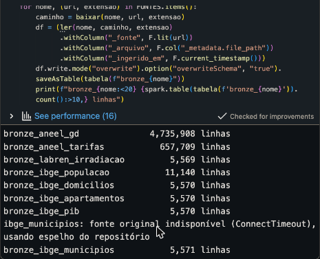

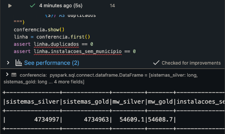

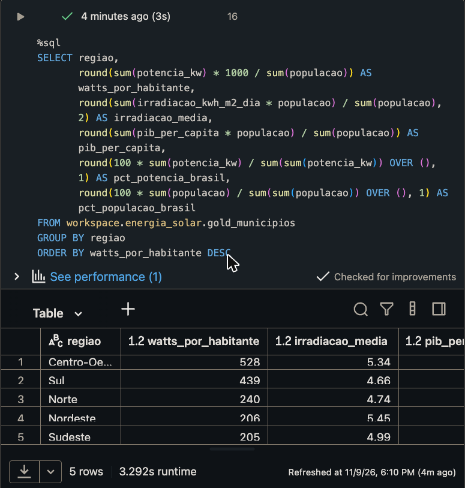

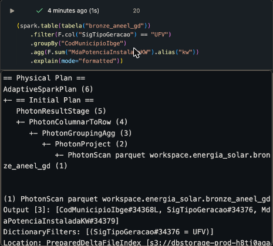

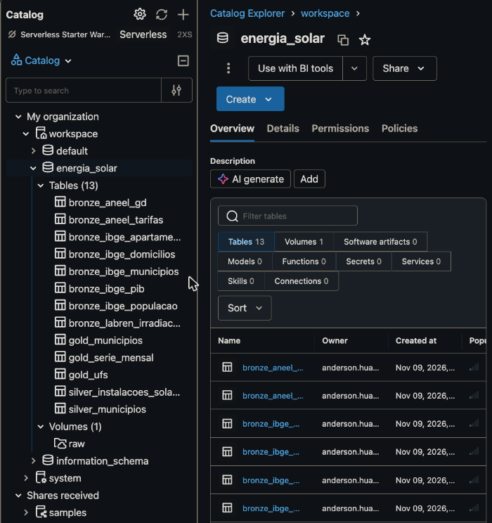

**Discussão.**

- **Características:** a mesma lógica foi escrita de forma declarativa e o otimizador do Spark decidiu a execução. No Databricks, o plano físico mostra o motor vetorizado Photon (`PhotonScan`, `PhotonGroupingAgg`), o filtro `SigTipoGeracao = 'UFV'` aplicado já na leitura da tabela Delta (`DictionaryFilters`) e a leitura de apenas 3 das 29 colunas (column pruning). No Spark local, o mesmo código gera a agregação em duas fases: soma parcial em cada partição (`partial_sum`), troca de dados por município (`Exchange hashpartitioning`) e soma final. Esse padrão é o que permite dividir o trabalho entre várias máquinas.
- **Possibilidades:** com a base histórica mensal da ANEEL (uma foto por mês desde 2018, centenas de milhões de linhas) ou com dados de medição horária das distribuidoras, o volume deixa de caber em uma máquina. O mesmo código roda em um cluster maior sem alterações. As tabelas Delta ficam disponíveis para SQL e dashboards sem exportar arquivos.
- **Limitações:** para 4,7 milhões de linhas, o DuckDB local é mais rápido de iterar (segundos, sem tempo de inicialização de cluster). A Free Edition tem cotas de computação, o modo ANSI do SQL exige `try_cast` e `nullif` para não quebrar com dados sujos, e a junção aproximada de nomes, trivial em Python com `difflib`, precisou ser reescrita com `levenshtein` e janela.

## 10. Relatório executivo

Diagnóstico e recomendações em [`relatorio-executivo.md`](relatorio-executivo.md).

## 11. Indo além do enunciado: governança e linhagem de dados

> Esta seção é uma **contribuição adicional**, feita além do escopo pedido na atividade. Ela não altera nenhum dado, código ou resultado das seções anteriores: apenas documenta, no próprio banco, as tabelas que o pipeline já havia criado.

**Por que isso importa em um banco de dados na nuvem.** Em um ambiente compartilhado, com dezenas de tabelas e várias pessoas consultando, não basta os dados existirem: é preciso saber **o que cada tabela e coluna significa**, **de onde ela veio** e **se contém dados pessoais**. Sem isso, o data lake vira um "pântano de dados" em que ninguém confia. O Unity Catalog do Databricks resolve isso guardando esses metadados junto com as tabelas.

**O que foi feito** (notebook separado, [`databricks/extra_catalogo_linhagem.py`](databricks/extra_catalogo_linhagem.py)):

| Recurso | Como | Resultado |
|---|---|---|
| Descrição das tabelas | `COMMENT ON TABLE` | As 13 tabelas descritas, aparecendo na interface e no `information_schema` |
| Dicionário de dados no banco | `ALTER TABLE ... ALTER COLUMN ... COMMENT` | 59 colunas da Silver e da Gold documentadas, com unidade e fonte |
| Classificação por tags | `ALTER TABLE ... SET TAGS` | Cada tabela com `camada` (bronze, silver, gold), `fonte` (ANEEL, IBGE, INPE), `lgpd = sem_dados_pessoais` e `projeto` |
| Catálogo consultável por SQL | `information_schema.tables`, `table_tags` e `columns` | Os metadados podem ser consultados como qualquer tabela |
| Linhagem de dados | registrada automaticamente pelo Unity Catalog | Grafo mostrando de quais tabelas Bronze vem cada Silver, de qual Silver vem cada Gold e qual notebook fez cada escrita |

**Evidências.** O notebook foi executado no Databricks e exportado com as saídas: [`extra_catalogo_linhagem_executado.ipynb`](databricks/extra_catalogo_linhagem_executado.ipynb) (abre no GitHub) e [`extra_catalogo_linhagem_executado.html`](databricks/extra_catalogo_linhagem_executado.html).

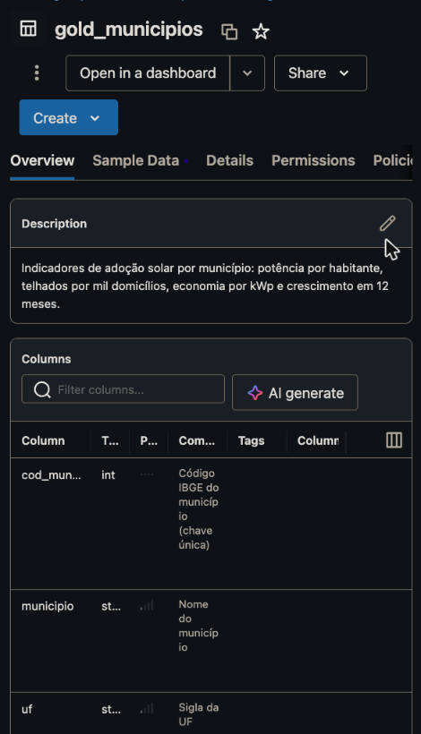

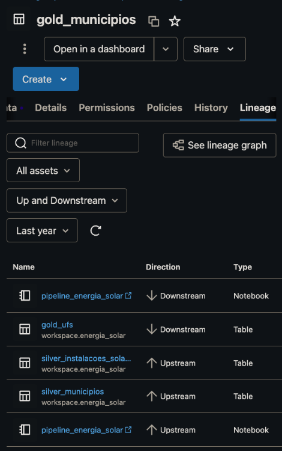

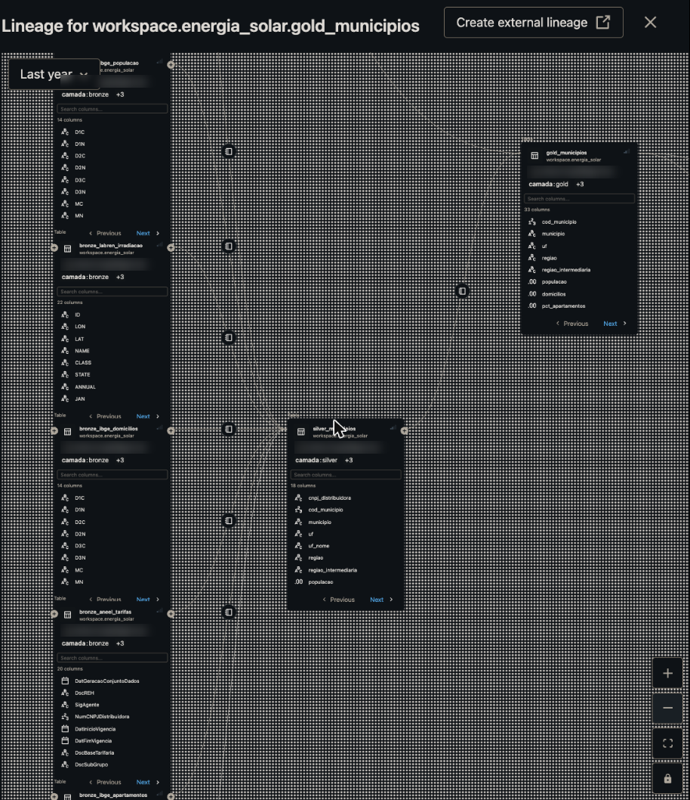

No grafo, cada caixa é uma tabela Delta com a sua tag `camada`: as tabelas Bronze do IBGE, do INPE e da ANEEL alimentam `silver_municipios`, que alimenta `gold_municipios`. O e-mail do dono das tabelas foi borrado no print.

**Observações.**

- A tabela de sistema `system.access.table_lineage` (consulta no fim do notebook) voltou vazia nesta execução: as tabelas de sistema do Databricks são atualizadas com algumas horas de atraso. A interface do catálogo, porém, já mostrava a linhagem completa, como nos prints acima.
- O notebook deve ser executado **depois** do pipeline principal, porque recriar as tabelas apaga os comentários e as tags.

## Estrutura do repositório

```
pipeline/            código do pipeline local (Bronze, Silver, Gold, análises, gráficos, dashboard)
databricks/          notebook PySpark do pipeline completo no Databricks e notebook extra de governança
docs/                dashboard, diagrama de arquitetura, figuras e resultados.json
data/                camadas raw, bronze, silver e gold (geradas pelo pipeline, fora do Git)
relatorio-executivo.md
```
